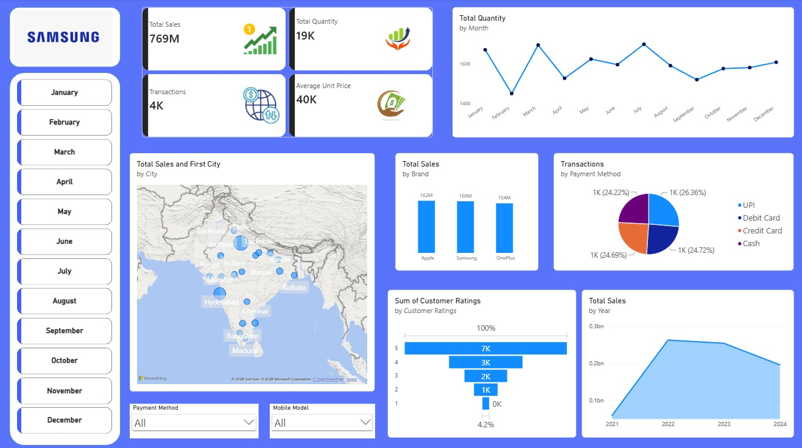

# Samsung Sales Analysis Dashboard | Power BI

An interactive Power BI project analysing mobile phone sales performance across brands, months, Indian cities, payment methods, customer ratings, and years. The dashboard presents key sales KPIs and interactive views to make performance easier to explore.

## Dashboard Preview

## Key Performance Indicators

| KPI | Dashboard Value |
|---|---:|
| Total Sales | 769M |
| Total Quantity Sold | 19K |
| Transactions | 4K |
| Average Unit Price | 40K |

*These values are transcribed from the supplied dashboard screenshot. Please validate them against the source dataset before using them for formal business decisions.*

## Analysis Included

- **Monthly performance:** quantity trends from January to December.
- **Geographic performance:** city-wise sales across India.
- **Brand comparison:** Apple, Samsung, and OnePlus.
- **Payment analysis:** UPI, debit card, credit card, and cash.
- **Customer feedback:** customer rating distribution.
- **Yearly performance:** sales trends from 2021 to 2024.
- **Interactive filters:** Month, Payment Method, and Mobile Model slicers.

## Tools & Skills Demonstrated

- Microsoft Power BI
- Data analysis and KPI reporting
- Interactive data visualization
- Power Query and DAX, where implemented in the report

## Project Files

- [Download the Power BI report](./Samsung_Sales_Analysis_Dashboard.pbix)
- [View the dashboard screenshot](./Samsung_Sales_Dashboard_Preview.jpeg)

## How to View the Report

1. Download the PBIX file from this repository.
2. Open it in **Microsoft Power BI Desktop**.
3. If Power BI prompts for the source data, reconnect the dataset and refresh the report.
4. Use the slicers to explore results by month, payment method, and mobile model.

## About the Author

**Md Jahid** — Data Analyst

- GitHub: [@MdJahid10080](https://github.com/MdJahid10080)
- LinkedIn: [Md Jahid](https://www.linkedin.com/in/md-jahid-039207371)
- Email: [jmd10080@gmail.com](mailto:jmd10080@gmail.com)

---

If you find this project useful, feel free to star the repository and share feedback.
